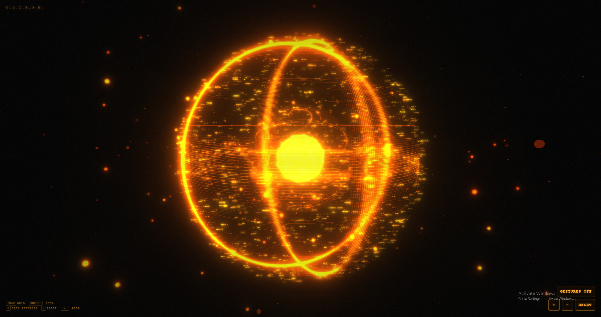
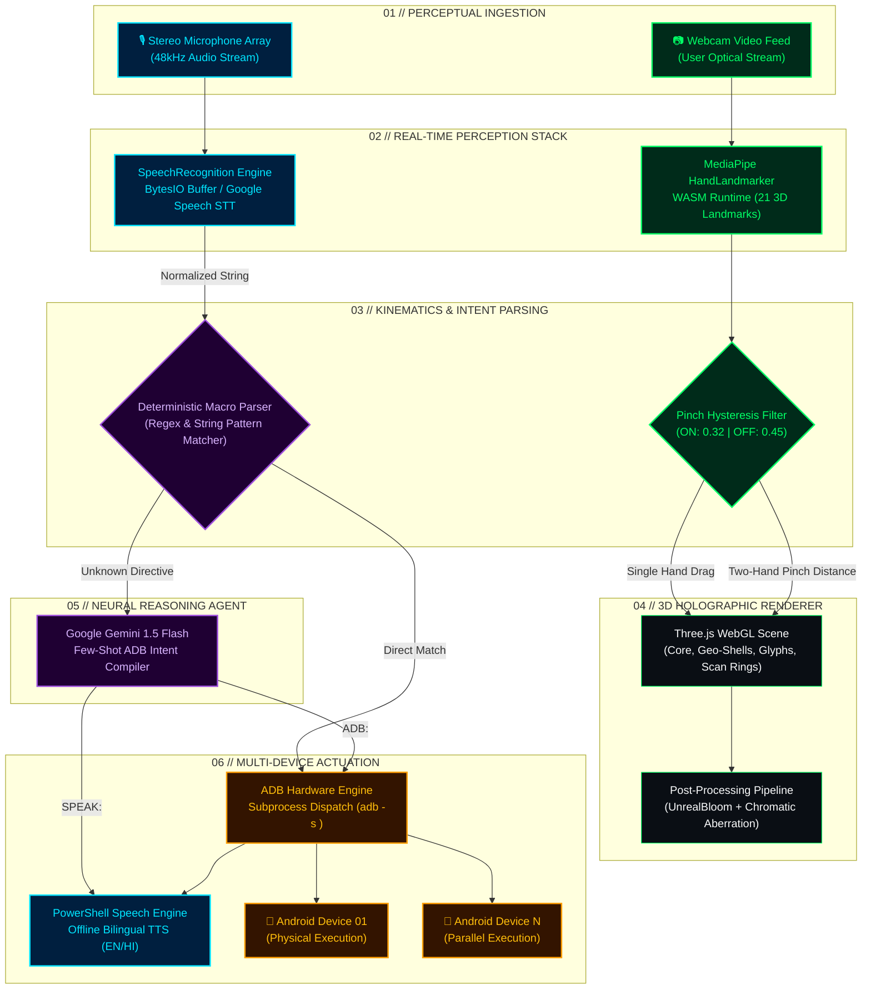

<div align="center">

# ⚡ ULTRON AI // CYBERNETIC COMMAND INTERFACE
### HOLOGRAPHIC THREE.JS HUD • MEDIAPIPE GESTURE TELEMETRY • MULTI-DEVICE ADB BRIDGE • GEMINI 1.5 FLASH

[](https://git.io/typing-svg)

<p align="center">
  
  
  
  
  
  
  
  
</p>

---

<p align="center">
  <strong>An Iron Man–inspired holographic command console fusing real-time contact-free computer vision hand tracking with a high-performance voice-driven Android hardware automation engine.</strong>
</p>

<p align="center">
  <a href="#-system-overview">Overview</a> •
  <a href="#-architectural-workflow">Architecture</a> •
  <a href="#-core-capabilities">Key Features</a> •
  <a href="#-hardware--gesture-controls">Controls</a> •
  <a href="#-tech-stack-matrix">Tech Stack</a> •
  <a href="#-repository-structure">Structure</a> •
  <a href="#-quickstart-guide">Quickstart</a> •
  <a href="#-ai--vision-pipeline">AI Pipeline</a> •
  <a href="#-security-posture">Security</a> •
  <a href="#-troubleshooting">Diagnostics</a>
</p>

---



</div>

---

## 📑 TABLE OF CONTENTS

- [⚡ System Overview](#-system-overview)
- [🎯 Problem Statement & Engineering Solution](#-problem-statement--engineering-solution)
- [🔄 Architectural Workflow](#-architectural-workflow)
  - [End-to-End Pipeline Diagram](#end-to-end-pipeline-diagram)
  - [Sequence Interaction Flow](#sequence-interaction-flow)
- [🧩 Core Capabilities](#-core-capabilities)
  - [1. Holographic 3D Spatial Orb UI](#1-holographic-3d-spatial-orb-ui)
  - [2. Zero-Latency Hand Tracking Engine](#2-zero-latency-hand-tracking-engine)
  - [3. Multi-Device Android Hardware Bridge](#3-multi-device-android-hardware-bridge)
  - [4. Dual-Mode Voice Command & Cognitive LLM Brain](#4-dual-mode-voice-command--cognitive-llm-brain)
  - [5. Native Offline Voice Synthesis (TTS)](#5-native-offline-voice-synthesis-tts)
- [🎮 Hardware & Gesture Controls](#-hardware--gesture-controls)
- [🛠️ Tech Stack Matrix](#️-tech-stack-matrix)
- [📂 Repository Structure](#-repository-structure)
- [🚀 Quickstart Guide](#-quickstart-guide)
  - [Prerequisites](#prerequisites)
  - [1. Clone Repository](#1-clone-repository)
  - [2. Python Backend Initialization](#2-python-backend-initialization)
  - [3. Frontend Web Console Initialization](#3-frontend-web-console-initialization)
  - [4. Android Hardware Bridge Setup](#4-android-hardware-bridge-setup)
- [🧠 AI & Vision Pipeline Deep Dive](#-ai--vision-pipeline-deep-dive)
  - [Computer Vision Tracking & Hysteresis Algorithm](#computer-vision-tracking--hysteresis-algorithm)
  - [Google Gemini 1.5 Flash Intent Compilation](#google-gemini-15-flash-intent-compilation)
  - [Audio Sampling & Noise Filtering](#audio-sampling--noise-filtering)
- [🛡️ Security Posture & Hardening](#️-security-posture--hardening)
- [🧪 Testing & Verification](#-testing--verification)
- [🔧 Troubleshooting & Diagnostics](#-troubleshooting--diagnostics)
- [🗺️ Future Development Roadmap](#️-future-development-roadmap)
- [🤝 Contributing](#-contributing)
- [📜 License & Credits](#-license--credits)

---

## ⚡ SYSTEM OVERVIEW

**ULTRON-AI** is a dual-tier cybernetic command system combining a futuristic WebGL cyber-deck user interface with an autonomous Android automation backend:

1. **Holographic Neural HUD (Frontend):** A 60 FPS Three.js WebGL holographic sphere rendered with layered geodesic wireframe shells, custom GLSL chromatic aberration shaders, bloom effects, floating cipher runes, dynamic debris fields, and client-side Google MediaPipe computer vision hand tracking via standard webcams.
2. **Autonomous Hardware Bridge (Backend):** A multi-threaded Python automation core interfacing through Android Debug Bridge (ADB), allowing hands-free control of one or more physical Android smartphones. It translates spoken natural-language directives into low-level Linux shell commands and Android Intents, with an integrated Google Gemini 1.5 Flash neural router for complex dynamic decision-making.

---

## 🎯 PROBLEM STATEMENT & ENGINEERING SOLUTION

| Traditional Voice Assistants | The ULTRON AI Solution |
| :--- | :--- |
| **Monolithic Cloud Silos:** Dependent entirely on third-party proprietary servers with high telemetry latency. | **Edge-Centric Architecture:** Runs locally with ultra-low latency WebGL graphics, local media streaming, and offline speech synthesis. |
| **Flat, Static 2D GUIs:** Generic chat bubbles and uninspiring list views. | **Cyberpunk Holographic HUD:** Interactive 3D spatial orb with real-time biometric hand tracking, responsive scan rings, and post-processing bloom. |
| **Sandboxed OS Constraints:** Incapable of deep physical hardware or multi-device phone control. | **Direct ADB Hardware Bridge:** Direct shell execution over USB/Wi-Fi to control power states, navigation, volume, camera shutters, and messaging without root permissions. |
| **Rigid Keyword Commands:** Fixed regex pattern matchers that break upon colloquial phrasing. | **Hybrid Deterministic + LLM Routing:** Instant execution for mission-critical macros backed by **Google Gemini 1.5 Flash** for arbitrary dynamic actions. |

---

## 🔄 ARCHITECTURAL WORKFLOW

### End-to-End Pipeline Diagram



---

### Sequence Interaction Flow

```mermaid
sequenceDiagram
    autonumber
    actor Operator as 👤 Operator
    participant HUD as 🔮 Next.js / Three.js HUD
    participant MP as 🖐️ MediaPipe WASM
    participant Core as 🐍 Ultron Backend
    participant Gemini as 🧠 Gemini 1.5 Flash
    participant ADB as ⚡ Android Debug Bridge
    participant Phone as 📱 Android Hardware

    %% Vision Loop
    rect rgb(0, 30, 20)
    Note over Operator,HUD: Spatial Kinematic Interaction
    Operator->>HUD: Present Hands in Camera FOV
    HUD->>MP: Process Frame Video Element
    MP-->>HUD: 21 Landmarks Normalized Coords
    HUD->>HUD: Compute Pinch Distance & Spatial Delta
    HUD->>HUD: Apply Orbit Matrix & Zoom Transforms
    end

    %% Voice Interaction Loop
    rect rgb(10, 20, 40)
    Note over Operator,Phone: Natural Voice Command Interaction
    Operator->>Core: Voice Directive ("Take a selfie and send WhatsApp")
    Core->>Core: 48kHz Stereo Capture & Transcribe
    Core->>Gemini: Prompt Intent Reasoning
    Gemini-->>Core: Emit "ADB: shell am start -a ..."
    Core->>ADB: Run Intent Dispatch across all connected devices
    ADB->>Phone: am start -a android.media.action.STILL_IMAGE_CAMERA
    Phone-->>ADB: Camera Active
    ADB->>Phone: input keyevent 27 (Shutter Trigger)
    Core->>Operator: Native Vocal Confirmation ("Selfie clicked. Ho gaya, aur kuch?")
    end
```



---

## 🧩 CORE CAPABILITIES

### 1. Holographic 3D Spatial Orb UI
- **Layered Volumetric Geometries:** Engineered with concentric icosahedron geodesic wireframe shells with counter-rotating axes.
- **Dynamic Orbital Particle Matrix:** Over 1,500 active star dust particles and randomized debris chunks in mathematical orbital planes.
- **Cyber Hologram Glyph Projections:** Floating code matrix glyphs generated dynamically via HTML5 canvas text-sprites in orbit around the core.
- **Cinematic Post-Processing Pipeline:** Built using Three.js `EffectComposer` combining `UnrealBloomPass` (emissive neon glow) with a custom GLSL `ShaderPass` rendering dynamic chromatic aberration and scanlines.
- **Implementation:** [`ultron-by-sagar-builds-main/lib/orbScene.ts`](file:///c:/Users/nikhi/Downloads/ultron-by-sagar-builds-main/ultron-by-sagar-builds-main/lib/orbScene.ts)

### 2. Zero-Latency Hand Tracking Engine
- **In-Browser Machine Learning:** Leverages Google MediaPipe `HandLandmarker` running over WebAssembly (WASM) with GPU acceleration.
- **Contact-Free Pinch Telemetry:** Tracks 21 anatomical landmarks per hand. Uses proportional Euclidean distance measurement relative to hand bounding scale:
  $$\text{Dist} = \frac{\|\mathbf{P}_{\text{thumb}} - \mathbf{P}_{\text{index}}\|}{\|\mathbf{P}_{\text{wrist}} - \mathbf{P}_{\text{middle\_mcp}}\|}$$
- **Hysteresis Smoothing:** Implements hysteresis cutoffs (`PINCH_ON = 0.32`, `PINCH_OFF = 0.45`) with exponential smoothing (`SMOOTHING = 0.4`) to prevent micro-jitter during 3D camera rotation and zoom.
- **Implementation:** [`ultron-by-sagar-builds-main/lib/handTracker.ts`](file:///c:/Users/nikhi/Downloads/ultron-by-sagar-builds-main/ultron-by-sagar-builds-main/lib/handTracker.ts)

### 3. Multi-Device Android Hardware Bridge
- **Parallel Device Dispatch:** Automatically polls `adb devices` to identify all connected target smartphones (USB or Wireless ADB over TCP/IP).
- **Automated Screen & Power:** Wakes devices (`keyevent 224`), initiates unlock swipe matrices, and toggles instant power locks (`keyevent 26`).
- **Universal Multi-Brand Camera Automation:** Executes universal intent overrides across Samsung, Xiaomi, Pixel, and OnePlus to force front-facing camera lenses:
  `shell am start -a android.media.action.STILL_IMAGE_CAMERA --ei android.intent.extras.CAMERA_FACING 1 --ei android.intent.extras.LENS_FACING_FRONT 1 --ez front true`
- **WhatsApp Deep Linking:** Automatically parses 10-digit phone numbers and URL-encoded message payloads to draft and route communications instantly via `whatsapp://send?phone=+91<number>&text=<payload>`.
- **Implementation:** [`ultron_backend.py`](file:///c:/Users/nikhi/Downloads/ultron-by-sagar-builds-main/ultron_backend.py)

### 4. Dual-Mode Voice Command & Cognitive LLM Brain
- **Deterministic High-Priority Macros:** Ultra-fast sub-millisecond local execution for standard hardware actions (volume control, home/back/recent apps navigation, battery diagnostic queries).
- **Google Gemini 1.5 Flash Cognitive Core:** When a spoken command falls outside hardcoded pattern heuristics, the backend queries Google's Gemini 1.5 Flash API with specialized prompt engineering. Gemini autonomously evaluates context, generates conversational replies (`SPEAK:`), or compiles native ADB shell commands (`ADB:`) directly on the fly.
- **Implementation:** [`ultron_backend.py` (lines 168–212)](file:///c:/Users/nikhi/Downloads/ultron-by-sagar-builds-main/ultron_backend.py#L168-L212)

### 5. Native Offline Voice Synthesis (TTS)
- **Zero-Dependency Vocal Feedback:** Utilizes Windows native PowerShell `System.Speech.Synthesis.SpeechSynthesizer` executed asynchronously without GUI blocking.
- **Bilingual Personality:** Speaks fluent English with colloquial Hindi confirmations (*"Ho gaya, aur kuch?"*), delivering an authentic personal AI companion experience.
- **Implementation:** [`ultron_backend.py` (lines 12–20)](file:///c:/Users/nikhi/Downloads/ultron-by-sagar-builds-main/ultron_backend.py#L12-L20)

---

## 🎮 HARDWARE & GESTURE CONTROLS

| Control Mechanism | Trigger / Input | Action & Technical Response |
| :--- | :--- | :--- |
| **🖐️ Single-Hand Pinch** | Pinch Thumb & Index + Drag | **Orb Rotation:** Calculates $\Delta\theta$ and $\Delta\phi$ spherical coordinates to rotate the 3D hologram in real time. |
| **👐 Dual-Hand Pinch** | Both Hands Pinched + Expand / Contract | **Orb Zoom:** Computes Euclidean distance delta between hand pinch anchors to zoom the camera closer or farther away. |
| **⌨️ Keyboard Shortcut** | `G` or `g` | **Toggle Hand Tracker:** Initializes or disposes webcam MediaPipe landmarker stream. |
| **⌨️ Keyboard Shortcut** | `R` or `r` | **Reset View:** Re-aligns Three.js camera to home coordinate `(0, 0.5, 5.5)`. |
| **⌨️ Keyboard Shortcut** | `+` / `-` | **Camera Zoom:** Incrementally magnifies or recedes the camera focal distance. |
| **🖱️ Mouse / Trackpad** | Left Click + Drag | **Manual Orbit:** Desktop fallback to spin the orb via Three.js `OrbitControls`. |
| **🖱️ Mouse Scroll** | Scroll Wheel / Trackpad Pinch | **Manual Zoom:** Fallback scaling between `0.6` and `40.0` distance bounds. |

---

## 🛠️ TECH STACK MATRIX

| Layer | Technology | Version | Purpose & Rationale |
| :--- | :--- | :--- | :--- |
| **Frontend Framework** | Next.js (App Router) | `^16.2.10` / `15+` | Server-side routing, static asset optimization, modern React architecture. |
| **UI Library** | React | `^19.2.7` | Component lifecycle orchestration and state management. |
| **3D Rendering Engine** | Three.js | `^0.185.1` | WebGL hardware-accelerated scene graphs, shaders, lighting, and camera matrices. |
| **Post-Processing** | Three.js Addons | `^0.185.1` | Unreal Bloom and custom GLSL chromatic aberration shaders. |
| **Computer Vision** | MediaPipe Tasks-Vision | `^0.10.35` | Client-side 21-landmark 3D hand tracking compiled to WebAssembly. |
| **Type Safety** | TypeScript | `^5.0.0` | Strict static typing and code reliability. |
| **Styling** | Vanilla CSS + Tailwind | — | Cyberpunk dark-mode HUD styling with scanline overlay effects. |
| **Backend Runtime** | Python | `>=3.10` | High-level orchestration for audio, ADB subroutines, and AI reasoning. |
| **Audio Capture** | SoundDevice & NumPy | `^0.4.6` | 48kHz dual-channel sound array stream management. |
| **Speech-to-Text** | SpeechRecognition | `^3.10.0` | Audio stream buffer transcription with Google Speech API support. |
| **Cognitive Brain** | Google Generative AI | `^0.8.0` | Gemini 1.5 Flash natural language intent-to-ADB compilation. |
| **Device Bridge** | Android Debug Bridge | Platform-Tools | Direct hardware control, intent dispatch, and shell execution on phones. |

---

## 📂 REPOSITORY STRUCTURE

```text
ULTRON-AI/
├── .env.example                          # Template for Gemini API key and environment config
├── .gitignore                            # Multi-tier gitignore (Node, Python, Next.js, keys)
├── README.md                             # Cyberpunk Master Documentation
├── requirements.txt                      # Python dependencies for the Ultron automation backend
├── ultron_backend.py                     # AI voice agent, Gemini router, & Android ADB bridge
├── docs/
│   └── screenshot.png                    # High-resolution screenshot of the 3D Holographic HUD
└── ultron-by-sagar-builds-main/          # Web Console Application (Next.js + Three.js)
    ├── package.json                      # Next.js, React 19, Three.js, & MediaPipe dependencies
    ├── tsconfig.json                     # TypeScript strict compiler configuration
    ├── next.config.ts                    # Next.js engine runtime settings
    ├── app/
    │   ├── globals.css                   # Global styles, CRT scanline effects, HUD styling
    │   ├── layout.tsx                    # HTML shell & font optimizations
    │   └── page.tsx                      # Main single-page application mount point
    ├── components/
    │   └── JarvisOrb.tsx                 # WebGL container, HUD overlay, webcam canvas glue
    ├── lib/
    │   ├── handTracker.ts                # MediaPipe WASM hand tracking & hysteresis algorithm
    │   └── orbScene.ts                   # Three.js scene, wireframe shells, bloom & shader passes
    └── docs/
        └── screenshot.png                # Asset backup
```

---

## 🚀 QUICKSTART GUIDE

### Prerequisites
- **Operating System:** Windows 10/11 (for native PowerShell TTS and sounddevice array selection), Linux, or macOS.
- **Node.js:** v18.18+ or v20+ with `npm` installed.
- **Python:** v3.10 or higher.
- **Android Platform Tools (ADB):** Must be accessible via terminal (`adb` in system `PATH`).
- **Webcam:** Any standard USB or laptop integrated webcam.
- **Android Device:** Developer Options enabled with **USB Debugging** active.

---

### 1. Clone Repository

```bash
git clone https://github.com/viRAJ357/ULTRON-AI.git
cd ULTRON-AI
```

---

### 2. Python Backend Initialization

#### Windows PowerShell:
```powershell
# 1. Create and activate a Python virtual environment
python -m venv venv
.\venv\Scripts\Activate.ps1

# 2. Install backend dependencies
pip install -r requirements.txt

# 3. Configure Google Gemini API Key
cp .env.example .env
# Edit .env and set your GEMINI_API_KEY, or set it directly in your terminal:
$env:GEMINI_API_KEY="your_actual_gemini_api_key_here"

# 4. Start the Ultron Backend Core
python ultron_backend.py
```

#### Linux / macOS:
```bash
# 1. Create and activate a Python virtual environment
python3 -m venv venv
source venv/bin/activate

# 2. Install backend dependencies
pip install -r requirements.txt

# 3. Set your Gemini API Key
export GEMINI_API_KEY="your_actual_gemini_api_key_here"

# 4. Start the Ultron Backend Core
python3 ultron_backend.py
```

---

### 3. Frontend Web Console Initialization

In a separate terminal window:

```bash
# Navigate to the web frontend directory
cd ultron-by-sagar-builds-main

# Install dependencies (React 19, Three.js, MediaPipe)
npm install

# Launch the Next.js development server
npm run dev
```

Open your browser at **[http://localhost:3000](http://localhost:3000)**.
- Press **`G`** or click **GESTURES OFF** to activate the webcam tracker.
- Allow camera permissions in your browser.
- Perform a pinch gesture to begin manipulating the holographic orb.

---

### 4. Android Hardware Bridge Setup

1. On your Android phone, navigate to **Settings > About Phone** and tap **Build Number** 7 times to enable Developer Options.
2. In **Settings > Developer Options**, enable **USB Debugging** (and **USB Debugging (Security settings)** if on MIUI/HyperOS).
3. Connect your phone via USB cable to your PC.
4. Verify device authorization in terminal:
   ```bash
   adb devices
   ```
   *Expected output:*
   ```text
   List of devices attached
   42008f51a79d2400    device
   ```

---

## 🧠 AI & VISION PIPELINE DEEP DIVE

### Computer Vision Tracking & Hysteresis Algorithm

The MediaPipe tracking pipeline processes the continuous video feed using the WebAssembly-backed `HandLandmarker` model:

```
Webcam Frame [60 FPS]
      │
      ▼
MediaPipe HandLandmarker (Float16 Tasks-Vision Model)
      │
      ├──> Wrist (ID 0)
      ├──> Thumb Tip (ID 4)
      ├──> Index Tip (ID 8)
      └──> Middle MCP (ID 9)
      │
      ▼
Normalize Pinch Ratio:
Dist = EuclideanDistance(Thumb, Index) / EuclideanDistance(Wrist, MiddleMCP)
      │
      ├──> If Dist < 0.32 (PINCH_ON)  --> State = PINCHING
      └──> If Dist > 0.45 (PINCH_OFF) --> State = RELEASED
      │
      ▼
Kinematic Transform:
• 1 Hand Pinched:  rotateBy(Δx * 5.0, Δy * 5.0)
• 2 Hands Pinched: zoomBy(newSpan / initialSpan)
```

### Google Gemini 1.5 Flash Intent Compilation

When an unmapped or complex voice instruction is uttered, `ultron_backend.py` constructs a structured system context for Google Gemini 1.5 Flash:

```text
SYSTEM CONTEXT:
You are Ultron, an AI assistant controlling an Android phone via ADB.
User Input: "<user_command>"

DECISION LOGIC:
1. If the request is conversational:
   Emit format: "SPEAK: <response_string>"
2. If the request demands smartphone action:
   Emit format: "ADB: <raw_adb_shell_command>"
```

This architecture allows the system to support commands not explicitly programmed into the codebase (e.g., *"turn on flashlight"*, *"take a screenshot"*, *"open spotify"*).

### Audio Sampling & Noise Filtering

Windows sound devices frequently raise `PaErrorCode -9998` when Bluetooth headphones are paired with mismatched sample rates. `ultron_backend.py` addresses this by automatically enumerating audio devices and selecting the internal stereo `Microphone Array` at a stable 48,000 Hz, recording directly into an in-memory `io.BytesIO` wave container before processing via Google Speech Recognition.

---

## 🛡️ SECURITY POSTURE & HARDENING

- **Zero Hardcoded Secrets:** The codebase utilizes `os.getenv("GEMINI_API_KEY")` with template fallback warnings, preventing accidental credential leaks to public repositories.
- **Defensive Shell Sanitization:** Single quotes and control characters are stripped from synthesized speech payloads to protect against PowerShell injection vulnerabilities.
- **Restricted ADB Surface:** Commands operate exclusively within standard user ADB shell bounds. No root escalation (`su`) or dangerous filesystem modification operations are permitted.
- **Client-Side Vision Processing:** All MediaPipe video frame processing executes locally in the user's browser sandbox. No video frames, screenshots, or webcam streams are ever transmitted to external servers.

---

## 🧪 TESTING & VERIFICATION

### Validating the Frontend
```bash
cd ultron-by-sagar-builds-main
npm run build
```
*Confirms strict TypeScript compilation, CSS bundling, and Next.js static asset optimization without errors.*

### Validating the ADB Bridge
```bash
# Verify ADB is connected and responsive
adb get-state
# Test volume toggle macro
adb shell input keyevent 24
```

### Validating the Voice Engine
```bash
python -c "import sounddevice as sd; print(sd.query_devices())"
```
*Ensures local audio inputs and recording channels are active.*

---

## 🔧 TROUBLESHOOTING & DIAGNOSTICS

### 1. `PaErrorCode -9998` or Audio Device Errors
- **Cause:** Bluetooth headset hands-free profile collision with Windows Sound API.
- **Fix:** Disconnect Bluetooth headsets or verify that your laptop's built-in **Microphone Array** is selected as the default input device in Windows Sound Settings.

### 2. `device unauthorized` in ADB
- **Cause:** Phone screen was locked during USB connection or RSA key fingerprint was not accepted.
- **Fix:** Unlock your Android device and tap **"Always allow from this computer"** when prompted. Run `adb kill-server && adb start-server`.

### 3. MediaPipe `CAMERA ACCESS DENIED`
- **Cause:** Browser denied webcam permissions.
- **Fix:** Click the lock or camera icon in your browser address bar and grant camera access to `localhost:3000`.

### 4. Gemini API Error or "Need a Gemini API Key"
- **Cause:** `GEMINI_API_KEY` was not configured or has expired.
- **Fix:** Generate a key at [Google AI Studio](https://aistudio.google.com/) and run:
  ```powershell
  $env:GEMINI_API_KEY="AIzaSy..."
  ```

---

## 🗺️ FUTURE DEVELOPMENT ROADMAP

- [x] Three.js Holographic Orb HUD with post-processing bloom and chromatic shaders
- [x] MediaPipe client-side hand tracking with pinch hysteresis
- [x] Multi-device Android ADB automation core
- [x] Google Gemini 1.5 Flash cognitive decision router
- [ ] **Phase 2.0:** Bi-directional WebSocket bridge connecting the Next.js HUD directly to the Python backend
- [ ] **Phase 2.1:** Real-time audio waveform visualizer synced to speech synthesis inside the 3D Orb
- [ ] **Phase 2.2:** On-device local LLM execution via Ollama (e.g., Llama 3 / Mistral) for 100% offline intelligence
- [ ] **Phase 2.3:** Wireless ADB auto-discovery via mDNS / Zeroconf

---

## 🤝 CONTRIBUTING

Contributions to ULTRON AI are welcome! Please follow these steps:

1. Fork the repository.
2. Create your feature branch (`git checkout -b feature/CyberneticEnhancement`).
3. Commit your changes (`git commit -m 'feat: implement real-time audio visualizer shaders'`).
4. Push to the branch (`git push origin feature/CyberneticEnhancement`).
5. Open a Pull Request.

---

## 📜 LICENSE & CREDITS

- **License:** Distributed under the **MIT License**. See `LICENSE` for details.
- **Frontend Holographic Concept:** Created by [Sagar Tamang](https://sagartamang.com/projects/ultron).
- **Architecture & AI Backend Expansion:** Engineered by [viRAJ357](https://github.com/viRAJ357).

---

<div align="center">
  <sub>⚡ ULTRON AI // AUTONOMOUS CYBER COMMAND DECK • MISSION READY ⚡</sub>
</div>
